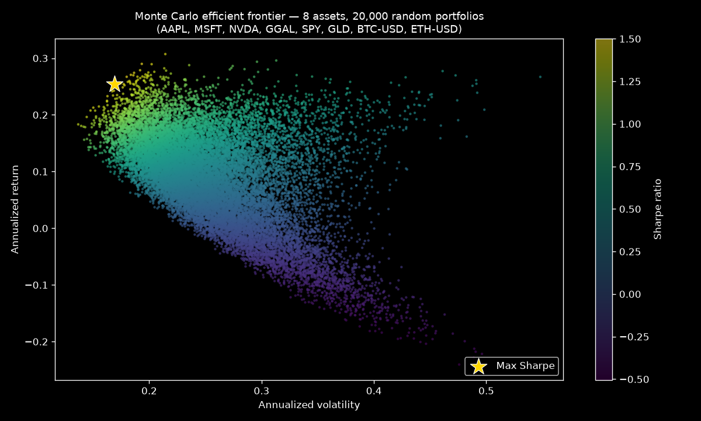
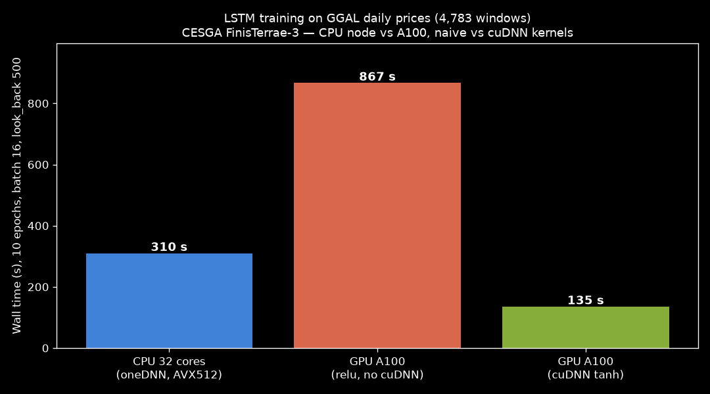

# quant-research-lab

[](https://github.com/maezgonz/quant-research-lab/actions/workflows/ci.yml)
[](LICENSE)

> Quantitative finance research codebase: market data pipelines, derivatives pricing, portfolio optimization and algorithmic trading utilities — focused on Argentine markets (BYMA, ROFEX/MAE, CCL/MEP) and crypto.

Curated, sanitized extraction of my working research repository. All credentials load from environment variables — see [`.env.example`](.env.example).



*Demo: [`examples/generate_efficient_frontier.py`](examples/generate_efficient_frontier.py) — 20,000 random portfolios (Dirichlet weights) over 1y daily data of equities, GGAL, gold and crypto, colored by Sharpe ratio.*

## Packages

| Package | Contents |
|---|---|
| `src/data/` | Market data connectors: BCRA, BYMA, Rava, MAE, dólar blue, CCL, Alpha Vantage, Nasdaq Data Link, Google Sheets |
| `src/models/` | Black-Scholes, Monte Carlo (crypto portfolios), delta-gamma exposure, IV surface, LSTM price forecasting |
| `src/portfolio/` | Risk metrics, HRP / risk parity, carry trade, portfolio audit, data912 |
| `src/trading/` | Backtesting engine, market making, pairs arbitrage |
| `src/quant/` | RBF/GP price prediction with news sentiment, regime detection, signal research |
| `src/defi/` · `src/crypto/` | DeFi and crypto-specific analytics |
| `src/core/` | Centralized config (dotenv), constants |
| `src/utils/` | Retry logic, network helpers |

## Setup

```bash
python -m venv .venv
.venv\Scripts\activate
pip install -r requirements.txt
copy .env.example .env   # fill in your own API keys
```

All API keys are **optional per module** — modules degrade gracefully or raise a clear error if their key is missing.

## Highlights

- **HRP / risk-parity allocator** with real broker-data ingestion
- **Monte Carlo crypto portfolio engine** — simulation, clustering of efficient portfolios (silhouette-scored), rolling Sortino
- **RBF kernel + Gaussian Process forecaster** blended with RandomForest and news sentiment (NewsAPI)
- **Argentine-market data layer** — BCRA, BYMA, Rava, MAE, CCL/MEP dollar rates in one interface

## GPU vs CPU on FinisTerrae-3 (A100)

Same LSTM architecture, same GGAL data (4,783 windows, look_back 500, 10 epochs):



| Config | Wall (s) | vs CPU | Lesson |
|---|---:|---:|---|
| CPU 32 cores (oneDNN, AVX512) | 310 | 1× | Baseline |
| GPU A100 — naive (relu activation) | 867 | **0.36× — 2.8× slower** | Without cuDNN-compatible activations, TF falls back to a generic kernel — the GPU *hurts* |
| GPU A100 — cuDNN (tanh/sigmoid) | 135 | **2.3×** | The same GPU, correct kernels |

The takeaway: **kernel selection > hardware** — a naive GPU port of an LSTM can be slower than a well-vectorized CPU (oneDNN) unless the activation functions are cuDNN-compatible (`tanh`/`sigmoid`, not `relu`). This is the bridge between the quant models and HPC — running the same research code on both architectures.

> Measured on CESGA FinisTerrae-3, jobs 10726308 (CPU), 10727674 (GPU naive), 10729025 (GPU cuDNN). Reproducible via `slurm/lstm_bench.slurm`.

## Notes

- Broker/live-trading connectors are **intentionally excluded** from this public repo.
- Historical market data files are not committed.
- See also: [quant-trading-models](https://github.com/maezgonz/quant-trading-models) (Monte Carlo & Greeks engines, C GBM kernel benchmarked on CESGA FinisTerrae-3).

## License

MIT — see [LICENSE](LICENSE).
